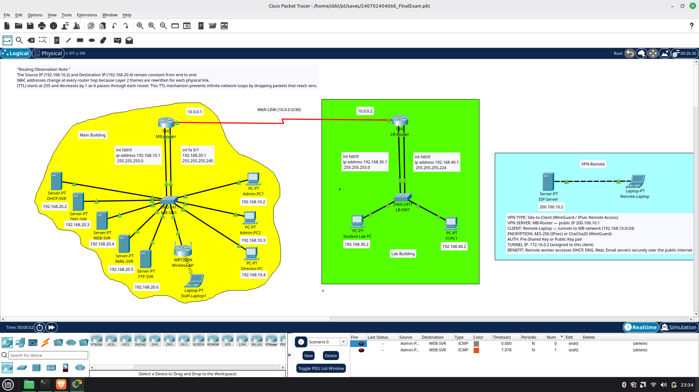

# KBU Campus Network Infrastructure

## Cisco Packet Tracer Network Design & Implementation



## Overview

This project simulates a university campus network built with Cisco Packet Tracer.

The network connects two buildings (Main Building and Lab Building) with secure communication, routing, network services, wireless access, and basic remote access design.

## Features Implemented

- Cisco router and switch configuration
- IPv4 addressing and subnetting
- OSPF dynamic routing
- ACL network security
- DHCP, DNS, Web, Email, and FTP services
- WPA2 wireless network
- VPN concept documentation
- Network troubleshooting and verification

## Network Design

```
Main Building
      |
   MB Router
      |
  WAN Serial Link
      |
   LB Router
      |
Lab Building
```

## Technologies Used

- Cisco Packet Tracer 8.x
- Cisco IOS CLI
- OSPF Routing
- Access Control Lists (ACL)
- DHCP / DNS / HTTP / FTP
- Wireless Networking

## Testing

Verified using:

- Ping connectivity tests
- OSPF neighbor verification
- Routing table checks
- ACL testing
- Network service testing

## Project Structure

```
├── topology
│   └── kbu-campus-network.pkt
│
├── screenshots
│
├── configs
│
└── documentation
```

## Skills Demonstrated

- Network design
- Cisco device configuration
- Routing and security concepts
- Network troubleshooting
- Infrastructure documentation

## Author

CKKL
